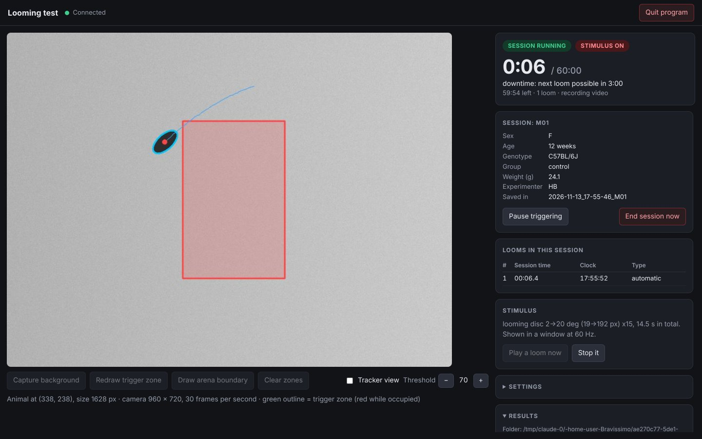

# Closed-loop looming-disc test

A Python program for the looming assay, operated from a control page in your web browser:

- it tracks one mouse in real time from an overhead camera,
- you draw a **trigger zone** on the live image with the computer mouse,
- when the animal is in the zone it plays a **looming stimulus** on a second
  monitor: an expanding disc drawn by the program, a movie file, or a folder of images,
- each animal gets a **timed session** (60 minutes by default) with a
  **downtime** after every loom (3 minutes by default),
- you type each animal's details into a form, and the **loom times**, the
  position trace and the camera video are saved per animal, plus two tables
  that collect all animals.



> **Status:** written and tested with a simulated mouse and a virtual screen.
> It has not yet been run with a real camera, a real second monitor or an
> animal, and only on Linux. See [What has been tested](#what-has-been-tested).

## Install

Python 3.9 or newer.

```bash
pip install -r requirements.txt
```

Run every command below from inside this `looming` folder.

## Try it first, without any equipment

```bash
python looming_test.py --demo
```

The control page opens in your browser and a grey stimulus preview window
appears. The demo uses a fake mouse, a 3-minute session and a 20-second
downtime so that you can see everything quickly. On the page:

1. Click **Test the stimulus** to see the disc.
2. Click **Draw trigger zone**, click the corners on the camera image, then **Finish**.
3. Type an Animal ID and click **Start session**.

A loom plays whenever the fake mouse is in the zone and the downtime is over;
each one appears in the "Looms in this session" table.

To try your laptop's built-in webcam (normally camera 0) with the stimulus in a window:

```bash
python looming_test.py --camera 0 --windowed
```

Point the camera at a plain surface, click **Capture background** with nothing
on it, then move a dark object into view: it is tracked like a mouse.

## Running an experiment

1. Connect the stimulus monitor and set the desktop to **Extend** (not Duplicate).
2. Find the camera and monitor numbers:

   ```bash
   python looming_test.py --list-cameras
   ```

   ```bash
   python looming_test.py --list-displays
   ```

3. Start the program:

   ```bash
   python looming_test.py --camera 1 --display 1
   ```

4. Once, on the control page, open **Settings** and enter the screen width and
   the distance from the animal to the screen (the disc size in degrees is
   computed from these), and check the session length, the downtime and the
   disc. Click **Apply settings**; they are remembered in `settings.json`.
5. Prepare the arena:
   - **Capture background** with the arena empty.
   - **Draw trigger zone**; optionally **Draw arena boundary** so that nothing
     outside the arena is tracked. Zones are remembered for next time.
   - **Test the stimulus** to check the monitor.
6. For each animal:
   - Fill in the **Next animal** form.
   - Put the animal in. If it is not outlined reliably, tick **Tracker view**
     and adjust **Threshold**.
   - Click **Start session**. The session stops by itself when its time is up
     and its results are saved; the form is then ready for the next animal
     (details that usually repeat are kept, the ID and notes are cleared).
7. **Quit program** when you are done. Keep the terminal window open while you work.

Closing the browser tab does not stop a session; open the address shown in the
terminal (normally http://127.0.0.1:8765/) to get the page back. The page only
works on the computer that runs the program.

## The control page

| Part | What it does |
| --- | --- |
| Camera image | Live view with the trigger zone (green, red while occupied), the arena boundary (yellow) and the tracked animal |
| Capture background | Stores a picture of the empty arena, used to find the animal |
| Draw trigger zone / arena boundary | Click the corners on the image; **Finish**, right-click or a click on the first corner closes the shape |
| Tracker view, Threshold | Shows what the tracker takes for the animal (white) so that you can tune it |
| Status | Session clock, time left, number of looms, and what the trigger is waiting for |
| Next animal | The details form, a checklist of what is still missing, and **Start session** |
| Pause triggering | No automatic looms while paused; the session clock keeps running. Zones and the background can only be changed while paused or between sessions |
| End session now | Stops early and saves what was recorded |
| Play a loom now | A manual loom: it is saved like the others and restarts the downtime |
| Settings | Session length, downtime, the disc, screen geometry, tracking, recording |
| Results | Opens the results folder; links to the tables of all animals and to each finished session's loom times |

`Esc` in the stimulus window closes it. Use that if it ever covers the wrong
screen; then quit and restart with the right `--display`.

## When a loom starts

During a session a loom starts when **all** of these hold:

- the animal has been inside the zone continuously for the dwell time (0.1 s by default),
- the downtime since the previous loom was triggered is over (180 s by default),
- the acclimation period at the start of the session is over (0 by default),
- no stimulus is playing and triggering is not paused.

"Inside" means that the centre of the tracked blob is inside the zone. With
the default rule, an animal that is still in the zone when the downtime ends
gets the next loom at that moment, and an animal that is in the zone when the
session starts gets one straight away (set an acclimation time to avoid that).
In **Settings → A loom can start** you can instead require that the animal left
the zone since the last loom, or that it enters after the downtime is over.

## What is saved

Everything goes in the `sessions` folder.

**For all animals together**

- `all_sessions.csv` - one row per session: the animal's details, date, start
  time, planned and actual length, how it ended, the number of looms and their
  times in seconds.
- `all_looms.csv` - one row per loom of every animal: the animal's details,
  the loom number, its time in the session (`onset_s`, and as minutes:seconds)
  and the clock time.

Both open in Excel. Close them in Excel before a session ends; if one cannot
be written, that session's rows go to a separate file next to it and the page says so.

**For each session**, a folder `<date>_<time>_<animal ID>` with:

- `looms.csv` - the loom times: `onset_s` (seconds since the session started
  when the stimulus appeared), `onset_mm_ss`, `clock_time`, `trigger_s` (when
  the program decided), `type` (auto or manual), the animal's position `x`,
  `y`, and `delay_ms` from the camera frame to the stimulus.
- `tracking.csv` - one row per camera frame: `t_s`, `x`, `y` (pixels),
  `area_px`, `detected`, `in_zone`, `armed`, `stim_on`, and `video_frame`
  (the matching frame in the video).
- `events.csv` - everything that happened, with times on the same clock.
- `video.mp4` - the raw camera image. It is written at a fixed frame rate, so
  use `t_s` in `tracking.csv` for timing, not the video's own clock. An hour of
  video is a large file; recording can be switched off in Settings.
- `session.json` (the animal's details and all settings and zones used) and `background.png`.

## Stimulus

**Expanding disc** (default). A dark disc on a grey screen grows from the start
diameter to the end diameter (in degrees of visual angle), stays, disappears
for the gap, and this repeats. All of these are in **Settings**. The defaults
(2° to 20° in 0.25 s, 0.25 s hold, 0.5 s gap, 15 discs) are modelled on the
widely used Yilmaz & Meister (2013) protocol; check them against the protocol
you are following before collecting data.

**Movie:**

```bash
python looming_test.py --movie my_loom.mp4
```

**Image sequence** (files are played in numeric order, e.g. `loom1.png`, `loom2.png`, ...):

```bash
python looming_test.py --images my_loom_frames
```

## Settings

The usual settings are on the control page and are saved in `settings.json`.
Everything else can be set by editing that file; `config.example.json` lists
every setting with its default, and a file only needs the ones you change. For
example, to ask different questions about each animal (the first one names the
session folder):

```json
{
  "session": {
    "animal_fields": ["Animal ID", "Sex", "Date of birth", "Cage", "Treatment", "Notes"]
  }
}
```

Other settings that are only in the file: the camera (`camera.source`,
`width`, `height`, `fps`), the stimulus monitor (`stimulus.display`,
`fullscreen`), disc colour, position and growth profile (`stimulus.loom`),
movie and image options, a photodiode patch (`stimulus.sync_patch`), and the
results folder (`output.dir`). Use `--config other.json` to keep several sets.

## Practical notes

- **Lighting.** The monitor changes the light in the arena when the disc
  appears, which can upset tracking during the stimulus. The usual solution is
  infrared lighting with a camera that only sees infrared. Fixed camera
  exposure (no auto-exposure) also helps.
- **Long sessions.** Set the computer not to sleep. The program asks the
  system to keep the screens on while it runs, but check this on your computer
  before a real hour-long session.
- **Latency.** The logged delay does not include the camera's own delay or the
  monitor's. To measure the true delay, enable `stimulus.sync_patch`, put a
  photodiode on it and compare with an LED in the camera's view.
- **One animal.** The tracker follows the single largest blob.

## What has been tested

Automated tests (`python -m pytest tests`) cover the tracker, the trigger
rules (including an hour with the default 3-minute downtime), the disc geometry
and timing, the stimulus window with disc, movie and image stimuli, complete
sessions with a simulated camera, the results tables, and the control page's
server. The control page itself was operated in a real browser (Chromium)
against the running program: drawing a zone, changing settings, two animals in
a row, pausing, ending early and quitting.

Not tested: a physical camera, a physical second monitor (including vertical
sync and real display timing), Windows and macOS, browsers other than
Chromium, and real animals. Expect to tune the tracking threshold for your
arena, and please check the stimulus timing on your own monitor before relying on it.
